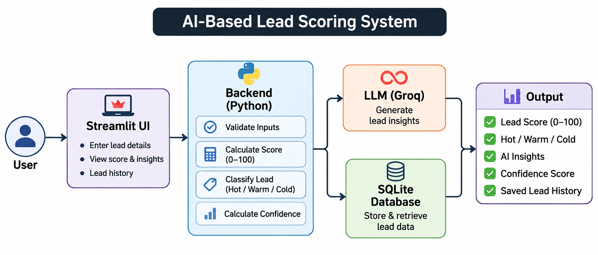
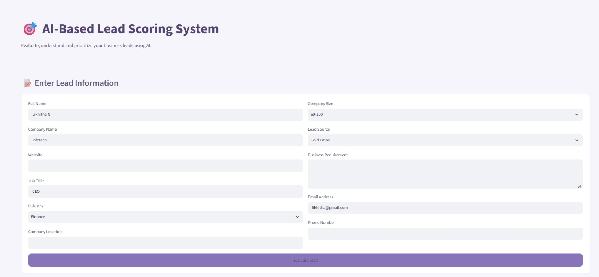
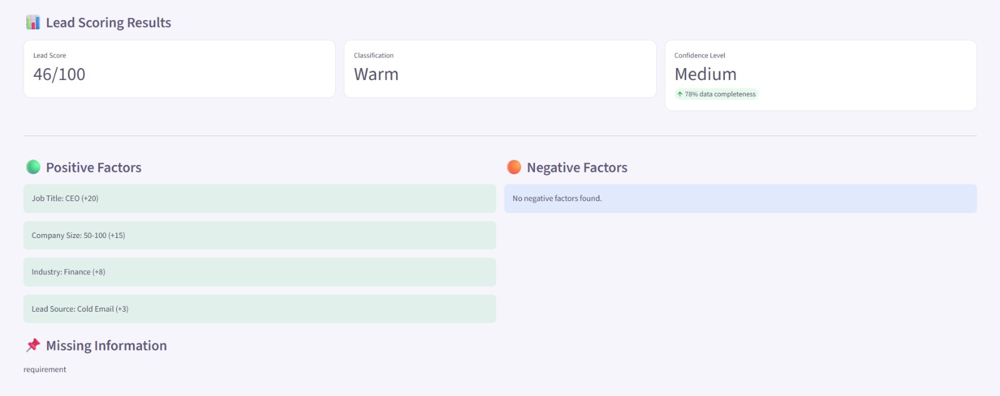
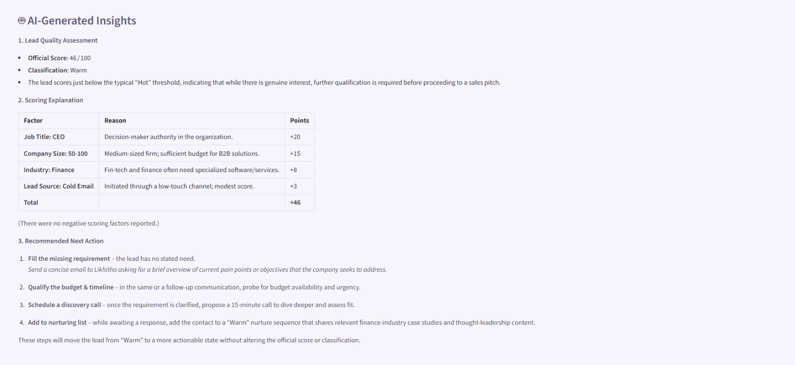
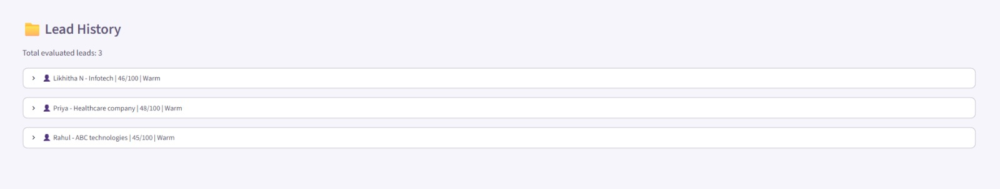

# 🎯 AI-Based Lead Scoring System

An AI-powered application that evaluates and prioritizes business leads using a transparent, rule-based scoring methodology and generates actionable sales insights using a Large Language Model (LLM).

Each lead gets a score between 0 and 100, a Hot, Warm or Cold classification, explainable scoring factors and AI-generated recommendations.

---

## 🏗️ System Architecture



---

## 📸 Application Screenshots

### 1. Lead Information Form


### 2. Lead Scoring Results


### 3. AI-Generated Insights


### 4. Lead History


---

## 🚀 Key Features

- **Rule-Based Scoring:** Consistent 0-100 score using predefined rules and weightages.
- **Lead Classification:** Hot, Warm or Cold.
- **Explainable Scoring:** Shows positive and negative scoring factors.
- **Buying Intent Analysis:** Keyword-based evaluation of the lead's requirement.
- **Missing Information Handling:** Missing data is reported separately and not treated as negative evidence.
- **Confidence Assessment:** Based on the completeness of the lead information.
- **AI-Generated Insights:** Quality assessment, scoring explanation and next action using Groq LLM.
- **Lead History:** Evaluated leads are stored in SQLite and kept after restarting the app.

---

## 🛠️ Technology Stack

| Category | Technology |
|---|---|
| Language | Python |
| Frontend | Streamlit |
| Validation | Pydantic |
| LLM | Groq API (openai/gpt-oss-20b) |
| Database | SQLite |
| Testing | Pytest |

---

## ⚙️ Scoring Methodology

| Scoring Parameter | Maximum Weightage |
|---|---:|
| Job Title | 20 |
| Company Size | 15 |
| Industry | 10 |
| Lead Source | 10 |
| Buying Intent | 30 |
| Company Profile Completeness | 10 |
| Contact Information Completeness | 5 |
| **Total** | **100** |

| Score Range | Classification |
|---|---|
| 70-100 | Hot |
| 40-69 | Warm |
| 0-39 | Cold |

**Role of the LLM:** The Python scoring engine decides the official score and classification. The Groq LLM only generates the lead quality assessment, scoring explanation and recommended next action. It never changes the score.

---

## 💻 Installation and Setup

```bash
git clone YOUR_GITHUB_REPOSITORY_URL
cd lead_scoring
python -m venv venv
venv\Scripts\activate
pip install -r requirements.txt
```

Create a `.env` file in the project root and add your Groq API key:

```env
GROQ_API_KEY=your_groq_api_key
```

Run the application:

```bash
streamlit run app.py
```

---

## 🧪 Testing

```bash
pytest -v
```

Tests cover score calculation, Hot/Warm/Cold boundaries, buying intent, missing information and consistency of results.